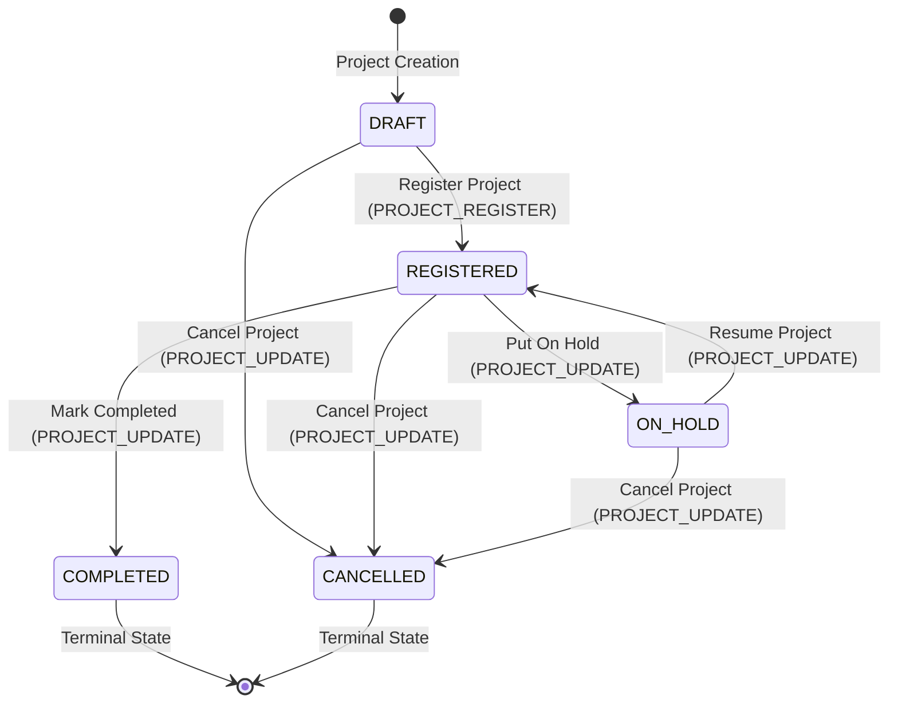

# NLAMS

National Land Acquisition Management System (NLAMS) is an enterprise platform designed to digitize, manage, and monitor land acquisition lifecycles, compensation disbursements, and geospatial parcel administration.

## Current Status

```text
Phase 2 — Step 3: Project Management Foundation + Agency Catalogue  ✓
Phase 2 — Step 2: User & Authority Management UI/API          ✓
Phase 2 — Step 1: Administrative Hierarchy Foundation + UI Shell ✓
Phase 1 — Step 4: Authorization Foundation                     ✓
Phase 1 — Step 3: Authentication Foundation                    ✓
Phase 1 — Step 2: Database Foundation                          ✓
Phase 1 — Step 1: Project Foundation                           ✓
```

## Stack

- **Next.js** (App Router)
- **React**
- **TypeScript** (Strict Mode)
- **pnpm** (Package Manager)
- **Zod** (Schema Validation)
- **PostgreSQL 15 + PostGIS 3.x**
- **Drizzle ORM 0.45** + drizzle-kit
- **postgres.js** (database driver)
- **@node-rs/argon2** (password hashing)

## Database Setup

### Prerequisites

- PostgreSQL 15 installed locally with PostGIS extension
- Create the database and enable PostGIS:

```sql
CREATE DATABASE nlams;
\c nlams
CREATE EXTENSION IF NOT EXISTS postgis;
```

### Environment

Create `.env.local` based on `.env.example`:

```env
DATABASE_URL=postgresql://postgres:<password>@localhost:5432/nlams
SEED_ADMIN_EMAIL=admin@nlams.gov.in
SEED_ADMIN_PASSWORD=YourSecurePassword
```

### Database Commands

```bash
# Generate migration from schema
pnpm db:generate

# Apply migrations to database
pnpm db:migrate

# Seed roles, permissions, hierarchy, and Super Admin
pnpm db:seed

# Verify database health
pnpm db:verify

# Open Drizzle Studio (visual DB browser)
pnpm db:studio
```

### Schema

10 core tables in `db/schema/`:

| Table | Description |
|---|---|
| `users` | System user accounts with Argon2id-hashed passwords |
| `roles` | System roles (SUPER_ADMIN, MINISTRY_ADMIN, etc.) |
| `permissions` | Individual action permissions |
| `role_permissions` | Many-to-many: roles → permissions |
| `user_roles` | Many-to-many: users → roles (with assignment tracking) |
| `administrative_units` | Self-referencing hierarchy (Central → State → District) |
| `user_assignments` | User → Administrative unit assignments |
| `sessions` | Server-side sessions storing SHA-256 hashed tokens with expiration |
| `implementing_agencies` | Government organizations & PSUs initiating infrastructure projects |
| `projects` | Infrastructure & land acquisition projects with exact numeric costs & codes |

## Phase 1 — Step 3: Authentication Foundation

NLAMS implements a secure, server-side session authentication architecture designed strictly around identity verification (*"Who are you?"*), completely decoupled from authorization and permissions (*"What can you do?"*).

```text
Browser
  │  HttpOnly Session Cookie (`nlams_session`)
  ▼
Next.js Route Handlers / Server Components
  │  Reads cookie via `getCurrentUser()` / `requireAuthentication()`
  ▼
Authentication Service (`src/services/auth/`)
  │  Hashes candidate token (SHA-256) & validates session state
  ▼
Repositories (`src/repositories/`)
  │  Drizzle ORM queries
  ▼
PostgreSQL (`sessions` + `users` tables)
```

### Core Authentication Features

- **Password Security:** Passwords hashed with **Argon2id** via `@node-rs/argon2` (OWASP parameters: 64 MiB memory, 3 iterations, 4 parallelism). Plaintext passwords and hashes are never exposed or logged.
- **Session Architecture:** 32-byte (256-bit) cryptographically random session tokens. Stored in PostgreSQL as **SHA-256 hashes** to protect against database compromise.
- **Immediate Revocation:** Immediate session invalidation upon logout or user deactivation (`status !== 'ACTIVE'`).
- **Transport Security:** Session tokens transmitted exclusively via **HttpOnly**, **SameSite=Lax**, **Path=/** cookies. Never stored in `localStorage` or `sessionStorage`.
- **Timing Attack Mitigation:** Generic `"Invalid email or password"` responses combined with dummy Argon2id verifications on non-existent accounts to eliminate timing side-channels and prevent email enumeration.

### Authentication Endpoints

| Method | Endpoint | Description | Auth Required |
|---|---|---|---|
| `POST` | `/api/auth/login` | Authenticate credentials, create server-side session, set HttpOnly cookie | No |
| `POST` | `/api/auth/logout` | Invalidate active session and clear cookie (idempotent) | Yes (safe if unauth) |
| `GET` | `/api/auth/me` | Retrieve profile of currently authenticated user | Yes |

### Server-Side Helpers

- `getCurrentUser(request?)`: Returns `SafeUser | null`. Works in both Route Handlers (`NextRequest`) and Server Components (`next/headers`).
- `requireAuthentication(request?)`: Asserts user is authenticated, throws `AuthenticationError` (401) if not. Serves as the protected route foundation for future modules.

---

## Phase 1 — Step 4: Authorization Foundation

NLAMS enforces a **three-layer authorization model** that strictly separates identity (authentication) from capability (authorization):

```text
requireAuthentication()     ← Who are you?        (Step 3)
        ↓
requirePermission(name)     ← What can you do?    (Step 4)
        ↓
requireAdministrativeScope  ← Where can you do it? (Step 4)
        ↓
canManageUser(actor, target) ← Can you act on this user? (Step 4)
```

### Authorization Model

- **RBAC:** Permissions are assigned to roles (`role_permissions`), not users. Users hold roles (`user_roles`). Changing a role's permissions propagates to all holders.
- **Administrative Scope:** Users are assigned to administrative units (`user_assignments`). Their scope includes their assigned units **plus all descendants**, resolved via PostgreSQL recursive CTEs at arbitrary hierarchy depth.
- **Hierarchical Authority:** `canManageUser()` enforces: (1) required permission, (2) Super Admin bypass, (3) no downgrade of Super Admins, (4) role weight prevents lower-tier managing higher-tier, (5) target's units must be within actor's scope.
- **Data-Driven Hierarchy:** No `if role === 'STATE_ADMIN'` hard-coding. All hierarchy traversal uses `administrative_units.parent_id` relationships.

### 401 vs 403 Distinction

| Condition | Status |
|---|---|
| Missing / expired session cookie | `401 Unauthorized` |
| Authenticated but missing permission or scope | `403 Forbidden` |

### Authorization Endpoints

| Method | Endpoint | Description | Auth Required |
|---|---|---|---|
| `GET` | `/api/auth/permissions` | Returns full authorization context (roles, permissions, assignments) | Yes |

### Authorization Service Structure

```text
src/services/authorization/
├── permission.service.ts   # hasPermission(), hasRole(), requirePermission()
├── scope.service.ts        # isWithinAdministrativeScope(), requireAdministrativeScope()
└── authorization.service.ts # getUserAuthorizationContext(), canManageUser()

src/repositories/
├── role.repository.ts               # findRolesByUserId(), findRoleByName()
├── permission.repository.ts         # findPermissionsByUserId(), hasPermission()
├── administrative-unit.repository.ts # getDescendantUnitIds(), isDescendantOrSelf() (CTE)
└── user-assignment.repository.ts    # findActiveAssignmentsWithUnitsByUserId()
```

### Development Hierarchy (extended for authorization tests)

```text
Central Government (IND)
  ├── Karnataka (KA)
  │     ├── Bengaluru Urban (KA-BLR)
  │     │     └── Bengaluru North (KA-BLR-N)
  │     └── Mysuru (KA-MYS)
  └── Maharashtra (MH)
```

## Project Structure

```text
nlams/
├── src/                    # Primary Next.js application source
│   ├── app/                # App Router pages, layouts, and route handlers
│   ├── components/         # Reusable UI components
│   ├── features/           # Domain-specific feature modules
│   ├── lib/                # Generic utilities and helper functions
│   ├── services/           # Business and service layer
│   ├── repositories/       # Database access and persistence layer
│   ├── validators/         # Zod validation schemas
│   ├── types/              # Application-wide TypeScript type definitions
│   └── config/             # Minimal application configuration
├── worker/                 # Background worker process placeholder
│   ├── jobs/               # Background job definitions
│   ├── scheduler/          # Task scheduling logic
│   └── index.ts            # Worker initialization placeholder
├── db/                     # Database layer placeholder (Phase 1 Step 2)
│   ├── schema/             # Drizzle schemas
│   ├── migrations/         # Database migrations
│   ├── seeds/              # Database seed data
│   └── queries/            # Reusable SQL queries
├── mock-services/          # External integration simulation placeholders
│   ├── land-records/       # Land Records API mock
│   ├── payment/            # Payment API mock
│   └── identity/           # Identity / Verification API mock
├── ml/                     # Machine learning components
│   └── delay-prediction/  # Delay prediction model placeholder
├── public/                 # Static public assets
├── tests/                  # Automated testing directory
│   └── e2e/                # End-to-end tests placeholder (Playwright)
├── docs/                   # Architecture and project documentation
│   ├── architecture/       # Architectural overviews and specifications
│   ├── diagrams/           # C4 and system diagrams
│   ├── openapi/            # OpenAPI/Swagger specifications
│   └── adr/                # Architecture Decision Records
├── scripts/                # Administrative and operational scripts
│   ├── reset-db/           # Database reset script placeholder
│   ├── seed-admin/         # Admin account seeding placeholder
│   └── backup/             # Database backup script placeholder
├── .github/
│   └── workflows/          # GitHub Actions CI/CD workflows
├── next.config.ts          # Next.js configuration
├── tsconfig.json           # TypeScript configuration with strict mode
├── package.json            # Project manifest, dependencies, and scripts
├── .env.example            # Environment variable template
├── .gitignore              # Git ignore rules
└── README.md               # Project documentation
```

## Running Locally

### Prerequisites

- Node.js (v20+ recommended)
- pnpm (v9+ / v11+)

### Installation

```bash
pnpm install
```

### Development Server

Start the local Next.js development server:

```bash
pnpm dev
```

The application will be available at `http://localhost:3000`.

### Code Quality & Build Verification

```bash
# Run automated test suite
pnpm test

# Run ESLint checks
pnpm lint

# Run TypeScript typecheck
pnpm typecheck

# Build production bundle
pnpm build
```

## Architecture Direction

The application enforces a clean separation of concerns across distinct layers:

```text
Next.js (App Router / Route Handlers)
   ↓
Services (Business Logic & Orchestration)
   ↓
Repositories (Data Access Abstraction)
   ↓
PostgreSQL / PostGIS (Relational & Spatial Database)
```

- **Next.js** handles routing, server-rendered views, and API entrypoints.
- **Services** encapsulate validation and business rules without direct database coupling.
- **Repositories** abstract query execution and data persistence.
- **PostgreSQL + PostGIS** will store relational domain data and geospatial boundary geometries starting in Phase 1 — Step 2.

## Phase 2 — Step 1: Administrative Hierarchy & Application UI Shell

### Administrative Hierarchy Model
- Data-driven hierarchy via self-referencing `administrative_units.parent_id`.
- Arbitrary hierarchy depth ($Level_1 \rightarrow Level_2 \dots Level_N$) with no fixed tier columns.
- PostgreSQL recursive Common Table Expressions (CTEs) for ancestor and descendant traversal.
- Circular hierarchy prevention at the service layer: units cannot be their own parent and cannot set a descendant as parent.

### Administrative Hierarchy API
Protected route handlers enforcing authentication, Zod validation, permissions, and administrative scope:

| Method | Endpoint | Description | Required Permission | Scope Enforced |
|---|---|---|---|---|
| `GET` | `/api/administrative-units` | List units (or hierarchy tree with `?tree=true`) | `ADMIN_UNIT_VIEW` | Scoped to assigned units |
| `POST` | `/api/administrative-units` | Create administrative unit | `ADMIN_UNIT_CREATE` | Scoped to parent unit |
| `GET` | `/api/administrative-units/:id` | Get unit details, ancestors, and child counts | `ADMIN_UNIT_VIEW` | Unit within scope |
| `PATCH` | `/api/administrative-units/:id` | Update unit details or parent relationship | `ADMIN_UNIT_UPDATE` | Unit and new parent within scope |
| `GET` | `/api/administrative-units/:id/children` | List immediate child administrative units | `ADMIN_UNIT_VIEW` | Unit within scope |
| `GET` | `/api/administrative-units/:id/tree` | Retrieve nested subtree rooted at unit | `ADMIN_UNIT_VIEW` | Unit within scope |

### Application UI Shell
- Reusable authenticated layout (`AppShell`, `Sidebar`, `Header`, `UserMenu`, `Breadcrumb`).
- `/login`: Government officer sign-in portal with Argon2id authentication.
- `/dashboard`: Welcome banner, authenticated officer role and scope summary, real administrative metrics from PostgreSQL, and roadmap modules grid.
- `/administrative-units`: Interactive hierarchy tree with node expansion, quick search/filter, unit detail panel, ancestor breadcrumbs, and permission-aware Create/Edit modals.

## Phase 2 — Step 2: User & Authority Management UI/API

### Module Structure
```text
src/
├── app/
│   ├── (dashboard)/
│   │   └── users/
│   │       ├── page.tsx                      # User list server component
│   │       ├── users-client.tsx              # Interactive table, search, filters, pagination
│   │       ├── new/
│   │       │   ├── page.tsx                  # Create user server component
│   │       │   └── create-user-client.tsx    # User provisioning form + temporary password display
│   │       └── [id]/
│   │           ├── page.tsx                  # User profile server component
│   │           └── user-details-client.tsx   # Profile info, roles & assignments management modals
│   └── api/
│       ├── users/
│       │   ├── route.ts                      # GET /api/users, POST /api/users
│       │   └── [id]/
│       │       ├── route.ts                  # GET /api/users/[id], PATCH /api/users/[id]
│       │       ├── roles/
│       │       │   ├── route.ts              # POST /api/users/[id]/roles
│       │       │   └── [roleId]/route.ts     # DELETE /api/users/[id]/roles/[roleId]
│       │       └── assignments/
│       │           ├── route.ts              # POST /api/users/[id]/assignments
│       │           └── [assignmentId]/route.ts # PATCH /api/users/[id]/assignments/[assignmentId]
│       └── roles/
│           └── route.ts                      # GET /api/roles (delegatable roles for actor)
├── repositories/
│   ├── user.repository.ts                    # User queries, paginated scope listing, atomic transactions
│   ├── user-assignment.repository.ts         # User administrative assignments data access
│   └── role.repository.ts                    # Roles, user-role associations, Super Admin count
├── services/
│   └── users/
│       ├── user.service.ts                   # User listing, details, atomic creation, profile update
│       ├── user-role.service.ts              # Role delegation, authority weights, assignment/revocation
│       └── user-assignment.service.ts        # Unit assignment, scope boundary checks, status updates
└── validators/
    └── users/
        ├── create-user.schema.ts             # Zod validation for user provisioning
        ├── update-user.schema.ts             # Zod validation for profile modification
        ├── assign-role.schema.ts             # Zod validation for role assignment
        ├── create-assignment.schema.ts       # Zod validation for administrative unit assignment
        ├── update-assignment.schema.ts       # Zod validation for assignment status/dates
        └── list-users.schema.ts              # Zod validation for paginated filtering
```

### API Endpoints

| Method | Endpoint | Description | Required Permission | Authorization Enforced |
|---|---|---|---|---|
| `GET` | `/api/users` | List users with pagination, search, and filters | `USER_VIEW` | Scoped to caller's administrative subtree |
| `POST` | `/api/users` | Create user with initial role and unit assignment | `USER_CREATE`, `ROLE_ASSIGN`, `USER_ASSIGN` | Unit within scope; role within delegatable rank |
| `GET` | `/api/users/[id]` | Retrieve user profile, roles, and assignments | `USER_VIEW` | In-scope or self (returns 404 for out-of-scope) |
| `PATCH` | `/api/users/[id]` | Update name, phone, or status | `USER_UPDATE` | Management authority; self status escalation blocked |
| `POST` | `/api/users/[id]/roles` | Assign an authorized role to a user | `ROLE_ASSIGN` | Cannot assign self; role weight $\le$ actor weight |
| `DELETE` | `/api/users/[id]/roles/[roleId]` | Revoke an authorized role from a user | `ROLE_ASSIGN` | Cannot revoke self; prevents removing last SUPER_ADMIN |
| `POST` | `/api/users/[id]/assignments` | Assign user to an administrative unit | `USER_ASSIGN` | Cannot assign self; target unit within scope |
| `PATCH` | `/api/users/[id]/assignments/[assignmentId]` | Update assignment status or end date | `USER_ASSIGN` | Cannot modify self; target unit within scope |
| `GET` | `/api/roles` | List roles that actor is authorized to delegate | `ROLE_ASSIGN` | Scoped by actor's maximum role authority weight |

### Role Delegation Rules
1. **Conservative Deny-by-Default**: Role delegation is governed strictly by the actor's permissions and relative authority weights (`SUPER_ADMIN`: 100, `MINISTRY_ADMIN`: 80, `PROJECT_OFFICER`: 60, `LAND_OFFICER`: 40, `FIELD_OFFICER`: 20).
2. **Super Admin Authority**: Super Admins possess national scope and can delegate any system role.
3. **Non-Super-Admin Restriction**: Non-Super-Admins can **never** grant `SUPER_ADMIN` privileges under any circumstance.
4. **Authority Inversion Prevention**: Officers cannot grant or revoke roles with authority weight exceeding their own highest role.
5. **Self-Escalation Prohibition**: Users cannot assign roles or administrative units to themselves, nor can they alter their own account status.
6. **Last Super Admin Protection**: The system enforces that at least one active `SUPER_ADMIN` must remain in the platform; revoking or deactivating the last Super Admin is rejected.
7. **Documented Limitation**: Role hierarchy is currently mapped through system roles and authority weights defined in code. Dynamic role delegation policies (e.g. per-ministry custom roles or temporary delegable powers) will be formalized in later governance steps.

### Administrative Scope Restrictions
1. **Data-Driven Subtree Scope**: Administrative scopes are derived dynamically from `user_assignments` joined with `administrative_units.parent_id` recursive CTEs.
2. **Branch Isolation**: Officers assigned to one branch (e.g., Karnataka) cannot view, manage, or assign users to another branch (e.g., Maharashtra).
3. **Peer Isolation**: Officers assigned to a district (e.g., Bengaluru Urban) cannot manage users in peer districts (e.g., Mysuru).
4. **Superior Protection**: Lower-level officers cannot manage officers at higher or superior tiers, even within the same administrative jurisdiction.
5. **Information Disclosure Policy**: Requesting user details or resources outside an officer's authorized administrative scope returns HTTP 404 (Not Found) rather than 403 (Forbidden) to prevent user ID enumeration.

### User Creation and Password Handling
1. **Atomic Creation**: User provisioning executes within a PostgreSQL transaction (`db.transaction`) ensuring the user record, role link, and administrative unit assignment succeed or fail together.
2. **Password Security**:
   - Initial passwords are generated as cryptographically secure random temporary passphrases (or accepted via validation).
   - Passwords are exclusively hashed using Argon2id with OWASP-recommended memory and parallelism settings via `@node-rs/argon2`.
   - Plaintext passwords and `password_hash` fields are never stored in plain text and are strictly omitted from all client responses and sanitized objects.
3. **Development Relay Limitation**: In the absence of an external transactional email provider (SMTP/SES), generated temporary passwords are presented to the administrator in a one-time secure visual alert with a copy button during provisioning. This limitation is intentional to avoid unauthorized external dependencies during Phase 2.

### Running Tests

```bash
# Run all automated tests (145 tests across all modules)
pnpm test

# Run User & Authority Management tests only
pnpm tsx --test tests/users/users.test.ts

# Run Implementing Agency catalogue tests only
pnpm tsx --test tests/agencies/agencies.test.ts

# Run Project Management tests only
pnpm tsx --test tests/projects/projects.test.ts
```

## Phase 2 — Step 3: Project Management Foundation + Government Agency Catalogue

NLAMS delivers the first complete Project Management module together with an authoritative seeded catalogue of government implementing agencies. Every project represents a government or public-purpose infrastructure initiative that may or may not require land acquisition.

### Architecture

```text
Next.js App Router (UI / API Route Handlers)
      │
      ├── GET, POST    /api/projects
      ├── GET, PATCH   /api/projects/[id]
      ├── POST         /api/projects/[id]/register
      ├── PATCH        /api/projects/[id]/status
      ├── GET          /api/implementing-agencies
      └── GET          /api/implementing-agencies/[id]
            │
            ▼
Service Layer (`src/services/projects/`, `src/services/implementing-agencies/`)
      │  Enforces Permissions: PROJECT_VIEW, PROJECT_CREATE, PROJECT_UPDATE, PROJECT_REGISTER
      │  Enforces Administrative Scope: Data-driven boundary traversal via recursive CTEs
      │  Enforces Status Transition Rules: Strict transition matrix & terminal states
      │  Enforces Active Agency Validation: Verified and active government agency check
            │
            ▼
Repository Layer (`src/repositories/project.repository.ts`, `src/repositories/implementing-agency.repository.ts`)
      │  Database queries only, SQL joins for agency and unit metadata
      │  Concurrency-safe project code generation via PostgreSQL sequence `project_code_seq`
            │
            ▼
Drizzle ORM 0.45 ──▶ PostgreSQL 15 (Tables: `projects`, `implementing_agencies`, `administrative_units`, `users`)
```

### Implementing Agency Catalogue & Provenance

The implementing agencies catalogue represents legitimate government ministries, departments, and public sector undertakings (PSUs) eligible to implement infrastructure projects. The initial catalogue is seeded idempotently from authoritative public government sources.

#### Seeded Implementing Agencies

| Code | Organization Name | Category | Administrative Unit | Official Website | Verified Public Source |
|---|---|---|---|---|---|
| `MORTH` | Ministry of Road Transport and Highways | `CENTRAL_MINISTRY` | Central Government (`IND`) | [morth.gov.in](https://morth.gov.in/) | [morth.gov.in](https://morth.gov.in/) |
| `NHAI` | National Highways Authority of India | `STATUTORY_AUTHORITY` | Central Government (`IND`) | [nhai.gov.in](https://nhai.gov.in/) | [nhai.gov.in](https://nhai.gov.in/) |
| `NHIDCL` | National Highways and Infrastructure Development Corporation Limited | `CENTRAL_PSU` | Central Government (`IND`) | [nhidcl.com](https://nhidcl.com/) | [nhidcl.com](https://nhidcl.com/) |
| `MOR` | Ministry of Railways | `CENTRAL_MINISTRY` | Central Government (`IND`) | [indianrailways.gov.in](https://indianrailways.gov.in/) | [indianrailways.gov.in](https://indianrailways.gov.in/) |
| `RVNL` | Rail Vikas Nigam Limited | `CENTRAL_PSU` | Central Government (`IND`) | [rvnl.org](https://rvnl.org/) | [rvnl.org](https://rvnl.org/) |
| `DFCCIL` | Dedicated Freight Corridor Corporation of India Limited | `CENTRAL_PSU` | Central Government (`IND`) | [dfccil.com](https://dfccil.com/) | [dfccil.com](https://dfccil.com/) |
| `KPWD` | Public Works Department, Government of Karnataka | `STATE_DEPARTMENT` | Karnataka (`KA`) | [kpwd.karnataka.gov.in](https://kpwd.karnataka.gov.in/) | [karnataka.gov.in](https://www.karnataka.gov.in/) |
| `KRDCL` | Karnataka Road Development Corporation Limited | `STATE_PSU` | Karnataka (`KA`) | [krdcl.karnataka.gov.in](https://krdcl.karnataka.gov.in/) | [krdcl.karnataka.gov.in](https://krdcl.karnataka.gov.in/) |
| `BMRCL` | Bangalore Metro Rail Corporation Limited | `STATE_PSU` | Bengaluru Urban (`KA-BLR`) | [english.bmrc.co.in](https://english.bmrc.co.in/) | [karnataka.gov.in](https://www.karnataka.gov.in/) |

#### Source Verification Meaning
> [!IMPORTANT]
> **Source verification means that the organization's public identity, legal name, and website were verified against authoritative official government directories.**
> It **DOES NOT** imply that:
> - The organization has completed a separate NLAMS accreditation workflow.
> - Any individual employee is automatically an authorized NLAMS user.
> - The organization has legal or statutory powers to acquire land without statutory notifications.
> - The agency catalogue permits public creation/editing via API: the catalogue is strictly **read-only** in application APIs.

#### Seed Script & Idempotency
- Run seed via: `pnpm db:seed`
- The seed script is completely idempotent: agency codes (`MORTH`, `NHAI`, etc.) serve as stable unique keys. Running the script multiple times reports `0 inserted, 0 updated, 9 unchanged, 0 skipped` and does not create duplicates.

### Project Database Schema

Stored in `db/schema/projects.ts`:

- `id`: UUID primary key (`gen_random_uuid()`).
- `projectCode`: Unique, system-generated identifier (`NLAMS-PRJ-000001`).
- `name`: Official project name (varchar 255).
- `description`: Optional project description (text).
- `projectType`: Controlled category (`Highway`, `Railway`, `Metro`, `Irrigation`, `Water Supply`, `Energy`, `Public Infrastructure`, `Other`).
- `implementingAgencyId`: Foreign key referencing `implementing_agencies.id` (`ON DELETE RESTRICT`).
- `administrativeUnitId`: Foreign key referencing `administrative_units.id` (`ON DELETE RESTRICT`).
- `createdBy`: Foreign key referencing `users.id` (`ON DELETE RESTRICT`).
- `landAcquisitionRequired`: Boolean flag (default `true`).
- `estimatedCost`: Exact numeric monetary storage (`numeric(18, 2)`). Floating point database types are strictly prohibited.
- `plannedStartDate`: Optional start date (`date`).
- `plannedEndDate`: Optional end date (`date`).
- `status`: Controlled project status (`DRAFT`, `REGISTERED`, `ON_HOLD`, `COMPLETED`, `CANCELLED`).
- `createdAt` / `updatedAt`: Timestamps with timezones.

### Project Code Generation
Project codes follow the format `NLAMS-PRJ-000001` and are generated concurrency-safely on the server using a dedicated PostgreSQL sequence:
```sql
CREATE SEQUENCE IF NOT EXISTS "project_code_seq" START WITH 1 INCREMENT BY 1;
```
Concurrent creation requests never clash, generate duplicate codes, or depend on race-condition row counts. Project codes, IDs, and creator identities are strictly server-controlled and rejected if supplied by clients.

### Project Lifecycle & Status Transitions



1. **New Projects start in `DRAFT`**: New projects must be reviewed before formal registration in NLAMS.
2. **Registration Action**: Requires `PROJECT_REGISTER` permission and moves project from `DRAFT` to `REGISTERED`.
3. **General Project Update Prohibition**: Arbitrary status transitions cannot be submitted through `PATCH /api/projects/[id]`. Status transitions are handled exclusively through dedicated endpoints (`/api/projects/[id]/register` and `/api/projects/[id]/status`).
4. **Terminal States**: `COMPLETED` and `CANCELLED` are terminal. Terminal projects cannot transition to other statuses and their core attributes cannot be modified.

### Permissions & Administrative Scope

1. **Role Permissions**:
   - `PROJECT_VIEW`: View projects and detailed metadata.
   - `PROJECT_CREATE`: Create new projects.
   - `PROJECT_UPDATE`: Update project attributes and non-registration status transitions.
   - `PROJECT_REGISTER`: Formally register draft projects.
   - Role assignments: `SUPER_ADMIN`, `MINISTRY_ADMIN`, and `PROJECT_OFFICER` hold full project management permissions. `LAND_OFFICER` and `FIELD_OFFICER` hold `PROJECT_VIEW` to support land assessment.
2. **Administrative Scope Containment**:
   - Super Admins have nationwide project management authority.
   - State and district officers can only create, list, view, edit, and transition projects located within their authorized administrative unit hierarchy.
   - Cross-scope project access returns `404 Not Found` to prevent project ID enumeration.
   - Selecting a national agency (e.g. NHAI) does not permit an officer to operate outside their assigned administrative boundary (e.g. a Karnataka officer cannot create a project in Maharashtra even if NHAI is the implementing agency).

### API Endpoints

| Method | Endpoint | Description | Permission | Scope Enforced |
|---|---|---|---|---|
| `GET` | `/api/implementing-agencies` | List active/all agencies with search & pagination | Authenticated | System-wide read-only catalogue |
| `GET` | `/api/implementing-agencies/[id]` | Get agency details and hierarchy | Authenticated | System-wide read-only catalogue |
| `GET` | `/api/projects` | List projects with search, status, type, and agency filters | `PROJECT_VIEW` | Scoped to user's administrative jurisdiction |
| `POST` | `/api/projects` | Create draft project with sequential code | `PROJECT_CREATE` | Target administrative unit must be within user's scope |
| `GET` | `/api/projects/[id]` | Retrieve full project, agency, and unit details | `PROJECT_VIEW` | 404 if project is outside user's scope |
| `PATCH` | `/api/projects/[id]` | Update editable fields (name, cost, dates, etc.) | `PROJECT_UPDATE` | 404 if outside scope; status changes rejected |
| `POST` | `/api/projects/[id]/register` | Transition DRAFT project to REGISTERED | `PROJECT_REGISTER` | Project must be in DRAFT and within user scope |
| `PATCH` | `/api/projects/[id]/status` | Transition project status (ON_HOLD, COMPLETED, CANCELLED) | `PROJECT_UPDATE` | Governed by transition matrix; terminal state checks |

### Explicit Exclusions & Deferred Functionality
In accordance with system design specifications, the following workflows are deliberately deferred to later phases:
- New agency registration and application submission.
- Agency verification or approval workflows.
- Agency-user membership tables and agency-specific authentication.
- Designated primary manager/controller per administrative unit.
- Multi-level statutory project approvals.
- Land parcel acquisition and compensation processing.
- GIS mapping and spatial overlays.

